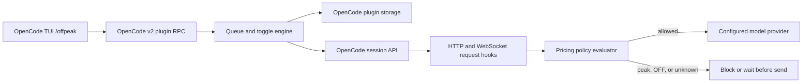
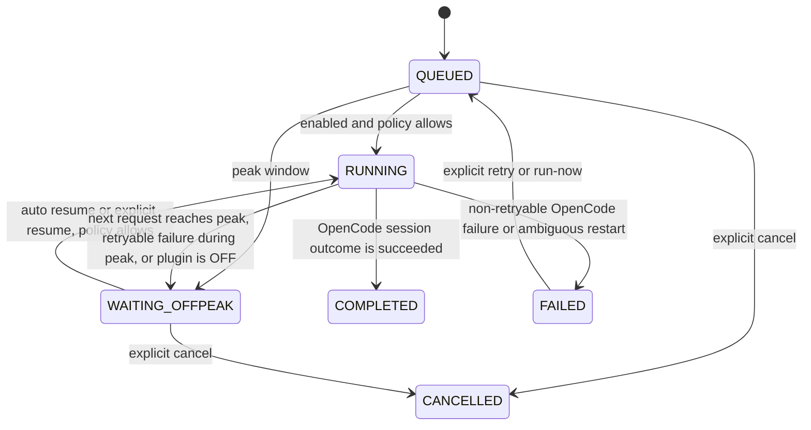

# Architecture

`opencode-offpeak` is one npm package with two OpenCode v2 entrypoints:

- `./server` owns the request guard, queue scheduler, config file, and OpenCode plugin-storage state.
- `./tui` registers `/offpeak` through the v2 keymap slash-command API and sends typed local RPC calls to the server entrypoint.

The plugin does not run a second agent runtime. OpenCode owns the sessions, model/provider, permissions, tools, transcript, and project context.

## Compatibility enforcement

Both entrypoints are defined with `Plugin.define(...)` and start by checking `context.app.version` against the tested range `>=2.0.26 <2.1.0` (validated against OpenCode 2.0.26 and 2.0.27; the same range declared in `package.json` `engines.opencode`). OpenCode releases before 2.0.26 activate TUI plugins outside the Solid keymap provider owner, so `context.keymap.layer()` fails with `Keymap.Provider is missing` there even though the plugin follows the documented API. On an unsupported host the plugin refuses to initialize with an explicit, actionable version error instead of reaching that confusing runtime failure.

## State and persistence

The queue is one versioned JSON document in OpenCode plugin storage. Each task stores its ID, prompt, working directory, provider/model, policy ID, state, explicit OpenCode session ID, timestamps, retry metadata, last error, and any expiring override. There is no database or second queue service.

The setting file is `$OPENCODE_CONFIG_DIR/offpeak.json` when `OPENCODE_CONFIG_DIR` is set; otherwise it is `$XDG_CONFIG_HOME/opencode/offpeak.json`, defaulting to `~/.config/opencode/offpeak.json`. `OPENCODE_OFFPEAK_CONFIG` can override the file path. It is canonical for the persistent enabled toggle, execution mode, display timezone, and policy definitions. Commands write it atomically with owner-only permissions. The queue remains in OpenCode storage.

## State machine

OFF does not delete state. It stops automatic starts and resumes. If a queued task is already active, the request guard allows the in-flight provider request to settle and blocks its next inference request. It preserves the session. OFF does not authorize peak pricing.

`COMPLETED`, `FAILED`, and `CANCELLED` tasks are terminal records. `/offpeak remove <task-id>` deletes a terminal record from the queue document; active tasks must be cancelled first. Removing a record never deletes the OpenCode session it references.

## Request guard and policy evaluation

The server plugin attaches through `context.session.hook()` to OpenCode v2's `http.request`, `experimental.ws.handshake`, and `experimental.ws.send` hooks. These run before the provider transport sends the request/frame. A queued `auto` task transitions to `WAITING_OFFPEAK` and holds that same session at the request boundary until the plugin is enabled and the pricing policy allows it (or its explicit override is still valid).

In `auto` mode, a normal interactive request for a supported model is held at the same boundary instead of being discarded. It creates no task and no session, is tracked only in server memory (shown by `/offpeak status`), and is released exactly once when the plugin is enabled and the policy allows. Wake-ups come from the shared config-change signal plus one timer scheduled for the policy's `nextTransition`; there is no polling loop. If the plugin shuts down while a request is held, the request fails closed as blocked rather than being sent under an uncertain pricing state. Requests in `queue`/`guard` mode, and requests that arrive while the plugin is OFF, are blocked immediately; OFF does not release a request that is already held.

### Peak-aware retry recovery

OpenCode retries retryable transport failures on its own (for the agent loop: attempts 2–4 with jittered backoff, denied at attempt 5). Each retry attempt is a new paid request, and every attempt re-enters the `http.request`/`ws` guard hooks, so a retry during peak would either be held (and time out while held, because the header-timeout clock starts at attempt start) or exhaust the retry budget and fail the turn.

The server plugin therefore also registers OpenCode's supported `retry` hook. The hook runs after OpenCode classifies a failure and before any retry is scheduled. When the plugin is ON in `auto` mode, the failure is retryable (`decision.retry === true`, or a retryable `provider.transport`/`provider.internal`/`provider.rate-limit` type after a retry sequence), and the policy blocks the model, the plugin sets `decision = { retry: false }` and records the recovery:

- A queue-owned task in `RUNNING` moves to `WAITING_OFFPEAK` (not `FAILED`) and keeps its session ID. The existing pump resumes it at the next allowed window with the safe continuation prompt.
- A normal interactive session is recorded in a small persisted recovery document scoped to the plugin location; at the next allowed window the engine sends the same safe continuation prompt into the same session.

Non-retryable failures (`provider.invalid-request`, `provider.auth`, `provider.quota`, `provider.content-filter`, …) are left untouched and still end as `FAILED`/error. Failures while pricing is allowed keep OpenCode's normal retry behavior. OFF, `queue`, and `guard` modes are unchanged. The continuation is a new state-aware turn; the failed provider request is never replayed byte-for-byte. A recovery whose session never settles is dropped without sending anything.

Policy matching uses provider IDs and exact/glob model IDs. A configured provider with an unknown model is `UNKNOWN` and blocked. Invalid timezone or schedule data is blocked. Providers without an installed policy are `UNTRACKED`; they are not covered by this plugin until a policy is added. Queue tasks must match a valid policy.

The built-in `deepseek-opencode-go` policy is defined once in `src/policy.ts`, in UTC. Time evaluation uses `Intl.DateTimeFormat` and the policy's IANA timezone, including weekday changes and DST. The user's display timezone does not change pricing boundaries.

## Queue execution and sessions

The scheduler is sequential. It has no polling loop: pending work schedules one timer for the next policy boundary, while a request already waiting sleeps on a signal and boundary timer. A task gets a new OpenCode session once. Pause/resume reuses the persisted session ID; a failed task can only continue after an explicit retry.

Completion uses OpenCode's session outcome (`succeeded`) after the session wait operation. Process exit alone does not complete a task. A session idle without a successful outcome is marked failed and requires an explicit retry.

## Recovery and delivery guarantees

OpenCode's v2 recovery is at-least-once, not exactly-once. If the plugin finds a task in `RUNNING` after plugin/server startup, it waits for its stored session. If OpenCode reports success, the task completes. Otherwise the outcome may be ambiguous, so the plugin marks it `FAILED` and does not send a duplicate prompt automatically. The user can inspect and explicitly retry the same session.

A `WAITING_OFFPEAK` record is written before the guarded request is allowed. That state is safe for automatic same-session resume in `auto` mode. Interactive holds are intentionally not persisted: they belong to a live provider request, so a server restart cannot release them and shutdown fails them closed instead. Retry recoveries for interactive sessions are persisted (minimal metadata: session ID, provider/model, location) because their provider request is already finished; a reload or restart during peak keeps the pending continuation, which is delivered only when the session has settled with a failed/interrupted outcome and pricing allows. A running OpenCode server is required for automatic timers; the plugin does not install or operate a separate daemon. The supported OpenCode background service can remain running when the TUI terminal closes. Machine-restart startup is delegated to the host OS service manager if desired.

## Override

`/offpeak run-now <task-id>` is a task-scoped, 15-minute override. It is persisted with an absolute expiry and shown in status while active. OFF pauses its use; it does not create or extend it. Expiry returns the next provider request to normal policy enforcement.

## Intentionally outside the architecture

- No second agent runtime, external scheduler, helper daemon, database, provider proxy, telemetry, billing aggregator, or web dashboard.
- No global `--continue` or implicit “last session” selection.
- No guarantee that a provider request already accepted before a boundary can be recalled.
- No exactly-once provider semantics across a crash where the provider outcome is ambiguous.
- No byte-for-byte replay of a failed provider request; recovery continues the session with a state-aware prompt instead.
