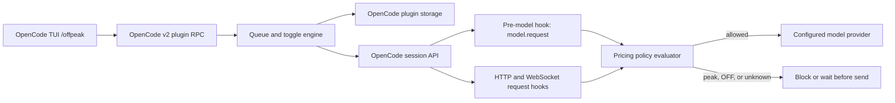
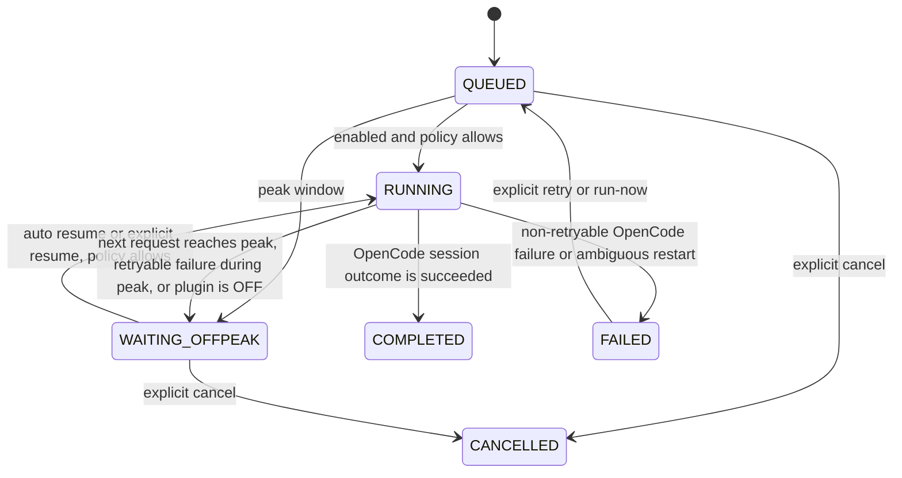

# Architecture

`opencode-offpeak` is one npm package with two OpenCode v2 entrypoints:

- `./server` owns the request guard, queue scheduler, config file, and OpenCode plugin-storage state.
- `./tui` registers `/offpeak` through the v2 keymap slash-command API and sends typed local RPC calls to the server entrypoint.

The plugin does not run a second agent runtime. OpenCode owns the sessions, model/provider, permissions, tools, transcript, and project context.

## Compatibility enforcement

Both entrypoints are defined with `Plugin.define(...)` and start by checking `context.app.version` against the tested range `>=2.0.26 <2.1.0` (validated against OpenCode 2.0.26, 2.0.27, and 2.0.30; the same range declared in `package.json` `engines.opencode`). OpenCode releases before 2.0.26 activate TUI plugins outside the Solid keymap provider owner, so `context.keymap.layer()` fails with `Keymap.Provider is missing` there even though the plugin follows the documented API. On an unsupported host the plugin refuses to initialize with an explicit, actionable version error instead of reaching that confusing runtime failure.



## State and persistence

The queue is one versioned JSON document in OpenCode plugin storage. Each task stores its ID, prompt, working directory, provider/model, policy ID, state, explicit OpenCode session ID, timestamps, retry metadata, last error, and any expiring override. There is no database or second queue service.

Session-scoped off-peak protection is a second, tiny plugin-storage document (`opencode-offpeak/session-overrides-v1`) that records only the sessions the user explicitly switched off (`protection: "off"` with an update timestamp); the absence of an entry means protection is ON, which is the default for every session. It is deliberately not part of `offpeak.json`: it describes one interactive session's explicit authorization, not an installation setting, and it survives reloads and restarts with the session. OpenCode's supported `session.deleted` event removes an entry when its session is deleted; otherwise stale entries are reaped by bounded lazy cleanup on start-up, session commands, and status reads. Only a confident "session not found" is ever treated as deletion — a transient error keeps the entry. There is no timer, no expiry, and no periodic sweep.

The setting file is `$OPENCODE_CONFIG_DIR/offpeak.json` when `OPENCODE_CONFIG_DIR` is set; otherwise it is `$XDG_CONFIG_HOME/opencode/offpeak.json`, defaulting to `~/.config/opencode/offpeak.json`. `OPENCODE_OFFPEAK_CONFIG` can override the file path. It is canonical for the persistent enabled toggle, execution mode, display timezone, and policy definitions. Commands write it atomically with owner-only permissions. The queue remains in OpenCode storage.

## State machine



OFF does not delete state. It stops automatic starts and resumes. If a queued task is already active, the request guard allows the in-flight provider request to settle and blocks its next inference request. It preserves the session. OFF does not authorize peak pricing.

`COMPLETED`, `FAILED`, and `CANCELLED` tasks are terminal records. `/offpeak remove <task-id>` deletes a terminal record from the queue document; active tasks must be cancelled first. Removing a record never deletes the OpenCode session it references.

## Request guard and policy evaluation

The server plugin registers two lifecycle points:

- `model.request` — runs while OpenCode prepares every model request (primary, compaction, title, generate), before the provider attempt and its response-header timeout exist. In `auto` mode this is where a peak-priced request is deferred: nothing is sent, no attempt timer runs, and the same session continues the same turn at the next allowed window.
- `http.request`, `experimental.ws.handshake`, and `experimental.ws.send` — run immediately before the provider transport sends the request/frame. These remain the final hard barrier: a blocked request never crosses them, and OFF/`queue`/`guard` modes block interactive requests here exactly as before.

A queued `auto` task transitions to `WAITING_OFFPEAK` and waits at whichever point it reaches first (normally `model.request`); its existing override still applies. In `auto` mode, a normal interactive request for a supported model is deferred the same way. It creates no task and no session, is tracked only in server memory (shown by `/offpeak status`), and is released exactly once when the plugin is enabled and the policy allows. Wake-ups come from the shared config-change signal plus one timer scheduled for the policy's `nextTransition`; there is no polling loop. If the plugin shuts down while a request is held, the request fails closed as blocked rather than being sent under an uncertain pricing state. Requests in `queue`/`guard` mode, and requests that arrive while the plugin is OFF, are blocked immediately by the transport guard; OFF does not release a request that is already held.

### Cancelling a held request

A caller that owns a routing decision can cancel the request this plugin is holding for a session through the `cancelHold` RPC method. `state` on the held request is the single authoritative transition, and it is mutated synchronously:

```
holding --pricing allowed--> committed   (dispatch wins; cancelHold reports "committed")
holding --cancelHold-------> refused     (cancellation wins; the request is refused at the boundary)
```

A session can hold several requests at once (the agent loop and an auxiliary title request are prepared concurrently), so holds are tracked per request and `cancelHold` cancels every waiting request of that session. A `refused` hold returns from the loop and arms a one-shot refusal keyed by session, provider, model, and kind. The transport-boundary hooks registered before the pricing guards consume it and replace the request with a credential-free placeholder aimed at a closed loopback endpoint, so OpenCode sees a retryable transport failure and its own retry policy decides what happens next. A placeholder is never re-evaluated by the guards. An armed refusal expires after 60 seconds and is dropped when a fresh hold starts for the same session, so it cannot refuse an unrelated request. `consumeRefusal` also suppresses this plugin's own retry recovery for that one failure, because a refusal is not a provider failure and the caller owns the follow-up.

The mechanism is deliberately generic: this plugin exports a capability, not a policy. It knows nothing about who calls it or why, a queue-owned hold is never cancellable this way, and an unused capability changes nothing.

### Session-scoped off-peak protection

`/offpeak session off` records an explicit per-session authorization for verified peak-priced inference; `/offpeak session on` removes it. The TUI resolves the current session from OpenCode's supported command context — `ui.router.current()` (the focused route) first, then the active entry of `ui.tabs.list()` — so the user never types a session ID; on the home screen, where no session is focused, the command refuses instead of guessing.

The override is checked inside the request guard after the fail-closed guards and only for requests that are not queue-owned: a request that evaluates `PEAK` under a verified policy is allowed immediately for that session, and `UNKNOWN`/invalid-configuration requests still fail closed. A hold that is already waiting re-reads the override after every signal wake-up, so switching protection off commits the same parked request through the existing signal — no re-send, no retry, no duplicate provider call, no polling loop. Persisted recovery entries for the session are released on the same pass, keeping the native order (pending compaction, primary continuation, title check); entries of other sessions and other classes are untouched. A refused or committed hold is never recalled, and switching protection back on changes nothing for a request already dispatched — the next request that crosses the guard waits normally again.

Precedence is explicit and documented: the per-session grant is newer and more specific than the global automation state, so it applies in `auto`, `queue`, and `guard` modes and while the plugin is globally OFF — for that one session only. `/offpeak off` itself stays passive (it pauses every queue start and auto-resume, releases nothing, and blocks every other session and every task). Background queue tasks never inherit the override, even when they run in the same OpenCode session; `/offpeak run-now <task-id>` remains the task-scoped authorization. Status reports the current session's protection and, at peak with protection off, renders `Pricing: PEAK` with `Requests: ALLOWED (session override)`.

### Auxiliary requests and pending titles

OpenCode prepares auxiliary requests with the same session identity as the agent loop: `compaction` (context summarization inside a turn), `generate` (stateless text generation), and `title` (automatic chat naming). Compaction and generate share the turn's fate: if their hold is interrupted, the primary recovery continuation re-runs the step and the auxiliary request is prepared again. An automatic title does not: OpenCode generates it once when the first input of an untitled root session is promoted, and a lost title request is not retried by OpenCode itself.

A held `compaction` request (manual `/compact` or automatic context compaction — both are the same `model.request` kind) persists a semantic `pending-compaction` marker. It is not a replay: as soon as the recovered session is settled and idle, the plugin admits OpenCode's own compaction again (`session.compact`), and the re-triggered request holds at the pre-model guard through the peak window exactly like the original. OpenCode's runner keeps a pending compaction ahead of queued prompts, so a compact-first workflow survives a lost hold with its order intact: compaction first, then the prompt that was waiting behind it. Earlier-started work is different: if a compaction is recovered alongside a primary continuation for the same session, both are admitted in the same pass — compaction first, continuation behind it — and the continuation is not treated as stale just because the compaction completed first.

A held `title` request therefore persists a semantic `pending-title` recovery marker (same minimal shape as a deferral: session ID, provider/model, location, timestamp, origin) instead of the primary continuation. A session can hold a primary continuation, a pending-title marker, and a pending-compaction marker at the same time; each class is superseded only by a fresh request of its own kind, and each transport-guard class (`title`, `compaction`, `primary`) clears only its own entry — a compact request can never clear a primary deferral or a pending title, and a `generate` request clears nothing. When the allowed window arrives the title marker is delivered as a check, never as a replay or a mutation:

- A session that already has a title — generated by OpenCode, generated by another process, or renamed by the user — clears the marker without any request, so a title is never overwritten and never generated twice.
- A session that still needs a title is left to OpenCode's own generation. Every path that loses a title hold (inactivity, supersede, shutdown, reload) also resumes the session — the plugin's same-session continuation or OpenCode's restart recovery — and that input promotion is OpenCode's native trigger for automatic naming. The marker waits for the title, clears once it appears, and is dropped with a diagnostic if no title appears within the settle cap; a later input promotion still names the session normally.
- OpenCode 2.0.27 exposes no plugin-facing regeneration call. The HTTP API's `PATCH /api/session/:id {"title": ""}` runs OpenCode's regeneration, but the plugin host's `session.update` (the only form a plugin can call) renames the session to an empty title instead. The recovery therefore mutates nothing; the `titleRecoveryWaiting` status field reports pending markers.

`UNKNOWN` stays fail-closed for every kind, including titles: a model with no policy entry produces no provider traffic at any hour until the policy is extended. The built-in Go policy avoids that for the models OpenCode actually requests by declaring the provider's documented flat-priced models explicitly (see `src/policy.ts` and `docs/pricing-policies.md`).

### Held-request notifications

A primary interactive request that enters a hold announces itself exactly once as a plugin RPC event (`rpc.opencode-offpeak.hold`, carrying the session, the next transition and a display-zone formatted deadline); the release of that same hold, or a persisted recovery that actually continues a session, emits at most one `rpc.opencode-offpeak.resume`. Events travel on OpenCode's own stream to whichever clients subscribe; the TUI entrypoint renders them as toasts, while a headless run has no subscriber and its stdout stays untouched. The engine announces a hold only for `kind === "primary"` requests and remembers the announcement per instance, so auxiliary `title`/`compaction`/`generate` holds are silent, queue-owned sessions keep their queue semantics, a user cancel never produces a resumption, and a reload or restart cannot duplicate a notification for one hold. Notifications never enter the session, the transcript, or the model context.

### Peak-aware retry recovery and the inactivity safety net

OpenCode retries retryable transport failures on its own (for the agent loop: jittered exponential backoff; header-timeout failures are bounded to three retries). Each retry attempt is a new paid request, and every attempt re-enters the whole hook chain, so a retry during peak would either be held or exhaust the retry budget and fail the turn.

The server plugin therefore also registers OpenCode's supported `retry` hook. The hook runs after OpenCode classifies a failure and before any retry is scheduled. When the plugin is ON in `auto` mode, the failure is retryable (`decision.retry === true`, or a retryable `provider.transport`/`provider.internal`/`provider.rate-limit` type after a retry sequence), and the policy blocks the model, the plugin sets `decision = { retry: false }` and records the recovery:

- A queue-owned task in `RUNNING` moves to `WAITING_OFFPEAK` (not `FAILED`) and keeps its session ID. The existing pump resumes it at the next allowed window with the safe continuation prompt.
- A normal interactive session is recorded in a small persisted recovery document scoped to the plugin location; at the next allowed window the engine sends the same safe continuation prompt into the same session.

OpenCode's location-activity sweep interrupts sessions whose location has had no durable events for 60 minutes (`session.execution.interrupted`, reason `inactivity`). The plugin subscribes to OpenCode's supported event stream and, for `inactivity` interrupts of sessions it is currently deferring, releases the hold and records the same persisted recovery so the session continues automatically at the next allowed window. `user` and `shutdown` interrupts are ignored by that path.

Non-retryable failures (`provider.invalid-request`, `provider.auth`, `provider.quota`, `provider.content-filter`, …) are left untouched and still end as `FAILED`/error. Failures while pricing is allowed keep OpenCode's normal retry behavior. OFF, `queue`, and `guard` modes are unchanged. The continuation is a new state-aware turn; the failed provider request is never replayed byte-for-byte. A recovery whose session never settles is dropped without sending anything.

Policy matching uses provider IDs and exact/glob model IDs. Each policy declares its peak-priced `models` (weekly `blocked` windows) and its `flatModels` (vendor-documented all-hours pricing, which evaluate `FLAT`: allowed with no transition and never held); `models` wins if a pattern matches both. A configured provider with an unmatched model is `UNKNOWN` and blocked with an actionable message. Invalid timezone or schedule data is blocked. Providers without an installed policy are `UNTRACKED`; they are not covered by this plugin until a policy is added, and a verified provider fact records the ones whose pricing is known to be flat (OpenCode Zen) so status output can explain that no policy is needed. Queue tasks must match a valid policy.

The built-in `deepseek-opencode-go` (provider `opencode-go`) and `deepseek-api` (provider `deepseek`, the direct API) policies are defined once in `src/policy.ts`, in UTC, sharing the same peak windows and the Chinese statutory holiday calendar in `src/holidays.ts`. When a stored configuration contains only unmodified copies of the shipped policies, a newly shipped built-in policy is appended at read time so existing installations gain it without editing the file; any customization makes the stored set authoritative. Time evaluation uses `Intl.DateTimeFormat` and the policy's IANA timezone, including weekday changes and DST; holiday dates are evaluated on the calendar's own timezone (`Asia/Shanghai`) so the host-local timezone never matters. The user's display timezone does not change pricing boundaries. Full-day off-peak exception dates override every weekday peak window, and `nextTransition` skips holiday peak windows.

## Queue execution and sessions

The scheduler is sequential. It has no polling loop: pending work schedules one timer for the next policy boundary, while a request already waiting sleeps on a signal and boundary timer. A task gets a new OpenCode session once. Pause/resume reuses the persisted session ID; a failed task can only continue after an explicit retry.

Completion uses OpenCode's session outcome (`succeeded`) after the session wait operation. Process exit alone does not complete a task. A session idle without a successful outcome is marked failed and requires an explicit retry.

## Recovery and delivery guarantees

OpenCode's v2 recovery is at-least-once, not exactly-once. If the plugin finds a task in `RUNNING` after plugin/server startup, it waits for its stored session. If OpenCode reports success, the task completes. Otherwise the outcome may be ambiguous, so the plugin marks it `FAILED` and does not send a duplicate prompt automatically. The user can inspect and explicitly retry the same session.

A `WAITING_OFFPEAK` record is written before the guarded request is allowed. That state is safe for automatic same-session resume in `auto` mode. A hold for a live request (interactive or queue-owned) is intentionally not persisted as a request: it belongs to a running OpenCode session, so a plugin/server shutdown fails it closed instead of replaying it; the OpenCode server's own execution-claim recovery can resume sessions interrupted by a crash, and the plugin enforces pricing when they come back. Retry recoveries and inactivity-released holds are persisted (minimal metadata: session ID, provider/model, location) because their provider request is already finished or the session was deliberately interrupted; a reload or restart during peak keeps the pending continuation, which is delivered only when the session has settled with a failed/interrupted outcome and pricing allows. A running OpenCode server is required for automatic timers; the plugin does not install or operate a separate daemon. The supported OpenCode background service can remain running when the TUI terminal closes. Machine-restart startup is delegated to the host OS service manager if desired.

Recovery delivery is guarded against live work so it can never duplicate it. `session.outcome` only changes at settlement, so a running turn still reports its previous outcome; the engine tracks holds that are still parked in this instance and the execution state reported by OpenCode's own `session.execution.started` / terminal events, and it skips (rather than delivers) any recovery whose session is currently owned by a live hold or a running execution — ending the hold or settling the execution wakes the engine again. That closes the race where a boundary release and a recovery admission could otherwise both fire for one request. Delivery itself stays at-most-once per entry (the entry is removed before the request is sent) and per class: a compaction marker is delivered as the semantic compaction re-trigger, a primary marker as the continuation prompt, a title marker as a check.

## Override

`/offpeak run-now <task-id>` is a task-scoped, 15-minute override. It is persisted with an absolute expiry and shown in status while active. OFF pauses its use; it does not create or extend it. Expiry returns the next provider request to normal policy enforcement.

`/offpeak session on|off` is the separate, session-scoped, non-expiring protection switch described above. The two overrides are independent and never converted into one another: a task override never applies to an interactive session, and a session override never applies to a queue task.

## Intentionally outside the architecture

- No second agent runtime, external scheduler, helper daemon, database, provider proxy, telemetry, billing aggregator, or web dashboard.
- No global `--continue` or implicit “last session” selection.
- No guarantee that a provider request already accepted before a boundary can be recalled.
- No exactly-once provider semantics across a crash where the provider outcome is ambiguous.
- No byte-for-byte replay of a failed provider request; recovery continues the session with a state-aware prompt instead.
